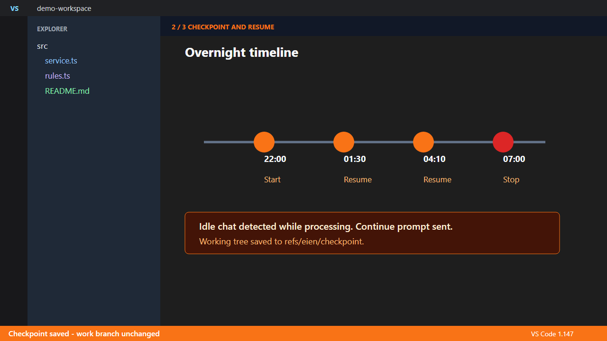

# Eien: overnight Copilot with a credit circuit breaker

Leave Copilot a task, not an uncontrolled bill. Before monitoring starts, Eien asks for this run's strict AI credit budget. If saved `copilotCredits` usage reaches the budget, Eien cancels the active Chat request, closes its monitoring loop, and never sends another continuation prompt.

Eien also resumes a chat that is still processing but has gone quiet, and saves each intervention as a rollback-ready Git checkpoint. In the morning, one report shows the credit usage, interventions, checkpoints, and reason for stopping.

It resumes only stalled processing, not completed conversations, and it does not modify your work branch or normal Git index.

[Japanese README](https://github.com/furukawa658/vscode-chat-tools/blob/main/extensions/eien/README.ja.md)

[Watch the demo](https://raw.githubusercontent.com/furukawa658/vscode-chat-tools/main/extensions/eien/images/demo.mp4)

## Features

| Feature | Details |
| --- | --- |
| Strict credit circuit breaker | Set a nightly AI credit budget when monitoring starts. Eien watches Copilot's saved `copilotCredits` delta every 15 s, cancels the active Chat at the limit, and stops all Eien interventions. |
| Resume stalled chats | When the chat has not updated for a set time (default 120 s) and the last request is still processing, it sends a continue instruction. Finished responses are left alone. |
| No stopping on questions | The instruction asks Copilot to write questions to `eien-questions.md` and move on to other work. |
| Rollback-ready records | The start state is saved as checkpoint #0, then each intervention is recorded under `refs/eien/checkpoint`. No work branch or normal index is changed. |
| Optional approval click | When enabled, Eien uses the OS accessibility API to click a known VS Code approval button. If no button is found or permissions are missing, it sends the normal continuation prompt instead. |
| Automatic stop | Stops at a time limit (default 8 h) or an intervention limit (default 20). |
| Morning report | Opens one report of the start, interventions, checkpoints, and stop. |

## How to use

1. After handing off your task, run `Eien: Start Overnight Monitoring` from the Command Palette.
2. Enter the AI credit budget allowed for this overnight run. Eien requires a number greater than zero and remembers the last value as the input default.
3. If usage reaches the budget, Eien cancels the active Chat and stops automatically. Otherwise, review the result with `Eien: Open Morning Report` in the morning.
4. Run `Eien: Stop Overnight Monitoring` at any time when manual monitoring control is needed.

## Safety

- It does not touch your work branch or your normal Git index. It uses a temporary index and a dedicated `refs/eien/checkpoint` history.
- Checkpoints are skipped while `.git/index.lock` exists. The start baseline makes rollback to the pre-run state possible.
- The circuit breaker reads the AI credit value stored in each local Copilot Chat session. It does not read your GitHub billing balance, and an in-flight request can consume credits before its saved value becomes available.
- At the budget limit, Eien cancels the active request and stops its timer. This prevents Eien from sending approval clicks or continuation prompts after the trip.
- Approval clicking is disabled by default. Enable `eien.autoClickApprovals` only when you accept the OS accessibility behavior.
- The checkpoint uses `commit-tree` with GPG signing disabled, so hooks and signing prompts cannot freeze overnight work.
- Checkpoints include untracked files. Do not keep credentials in the working tree.

## Good to know

- It reads the chat save format, which Copilot Chat does not publish. If it cannot read it, Eien does not start, and stops if running.
- Verified on VS Code 1.147 and Copilot Chat 0.75.

## Settings

| Setting | Default | Description |
| --- | --- | --- |
| `eien.idleSeconds` | 120 | Seconds without updates before a chat counts as stalled |
| `eien.maxHours` | 8 | Maximum running time |
| `eien.maxInterventions` | 20 | Maximum number of interventions |
| `eien.autoClickApprovals` | `false` | Click known chat approval buttons through the OS accessibility API, then fall back to a continuation prompt |

The strict circuit-breaker budget is entered interactively for each run so a previous night's allowance is not silently reused.

## Approval Click Prerequisites

| OS | Requirement |
| --- | --- |
| All | Set `"editor.accessibilitySupport": "on"` in VS Code settings. |
| Windows | No extra setup. Eien uses PowerShell UI Automation. |
| macOS | Allow `Visual Studio Code` under System Settings > Privacy & Security > Accessibility. |
| Linux | Install `python3-pyatspi` and `gir1.2-atspi-2.0`. If Wayland blocks accessibility access, start VS Code with `code --ozone-platform=x11`. |

## Related tools

| When you need... | Extension | Role |
| --- | --- | --- |
| Structured failures instead of raw build logs | [Zuma MCP](https://marketplace.visualstudio.com/items?itemName=ShunsukeF.inazuma-pwsh) | Returns concise build, test, lint, and type-check diagnostics. |
| A fresh chat before context gets overloaded | [Tsugi](https://marketplace.visualstudio.com/items?itemName=ShunsukeF.tsugi) | Creates a reviewed handoff prompt for the next chat. |
| Reusable rules from repeated corrections | [Ne](https://marketplace.visualstudio.com/items?itemName=ShunsukeF.ne-memory) | Turns recurring instructions into Copilot rules. |
| The complete Copilot Chat workflow | [Copilot Chat Power Pack](https://marketplace.visualstudio.com/items?itemName=ShunsukeF.vscode-chat-tools-pack) | Installs Tsugi, Eien, and Ne together. |

Bugs and requests: [GitHub Issues](https://github.com/furukawa658/vscode-chat-tools/issues). License: MIT.
