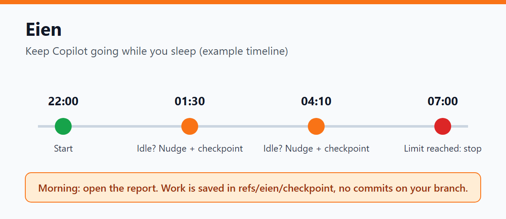

# Eien: keep Copilot going while you sleep

You hand off a long task and go to bed, and in the morning the chat stopped halfway. Eien reduces that waste. It sends a continue instruction only to a chat that is stuck while processing, records the working tree to a Git ref at each intervention, and gives you a report in the morning.

[日本語版 README](https://github.com/furukawa658/vscode-chat-tools/blob/main/extensions/eien/README.ja.md)

## Features

| Feature | Details |
| --- | --- |
| Resume stalled chats | When the chat has not updated for a set time (default 120 s) and the last request is still processing, it sends a continue instruction. Finished responses are left alone. |
| No stopping on questions | The instruction asks Copilot to write questions to `eien-questions.md` and move on to other work. |
| Rollback-ready records | At each intervention, the working tree is recorded to `refs/eien/checkpoint`. No extra branches, no hooks. |
| Automatic stop | Stops at a time limit (default 8 h) or an intervention limit (default 20). |
| Morning report | Opens one report of the start, interventions, checkpoints, and stop. |

## How to use

1. After handing off your task, run `Eien: 開始` (Start) from the Command Palette.
2. In the morning, run `Eien: 朝の報告を開く` (Open morning report).
3. Run `Eien: 停止` (Stop) when you no longer need it.

Command titles are shown in Japanese in the current version.

## Safety

- It does not touch your work branch or your normal Git index. It uses a temporary index.
- It does not click approval buttons or confirm edits automatically.
- Checkpoints include untracked files. Do not keep credentials in the working tree.

## Good to know

- It reads the chat save format, which Copilot Chat does not publish. If it cannot read it, Eien does not start, and stops if running.
- Verified on VS Code 1.147 and Copilot Chat 0.75.

## Settings

| Setting | Default | Description |
| --- | --- | --- |
| `eien.idleSeconds` | 120 | Seconds without updates before a chat counts as stalled |
| `eien.maxHours` | 8 | Maximum running time |
| `eien.maxInterventions` | 20 | Maximum number of interventions |

## Related extensions

- [Tsugi](https://marketplace.visualstudio.com/items?itemName=ShunsukeF.tsugi): hand off a long chat to a new one
- [Ne](https://marketplace.visualstudio.com/items?itemName=ShunsukeF.ne-memory): turn repeated corrections into rules
- Install all three: [Pack](https://marketplace.visualstudio.com/items?itemName=ShunsukeF.vscode-chat-tools-pack)

Bugs and requests: [GitHub Issues](https://github.com/furukawa658/vscode-chat-tools/issues). License: MIT.
