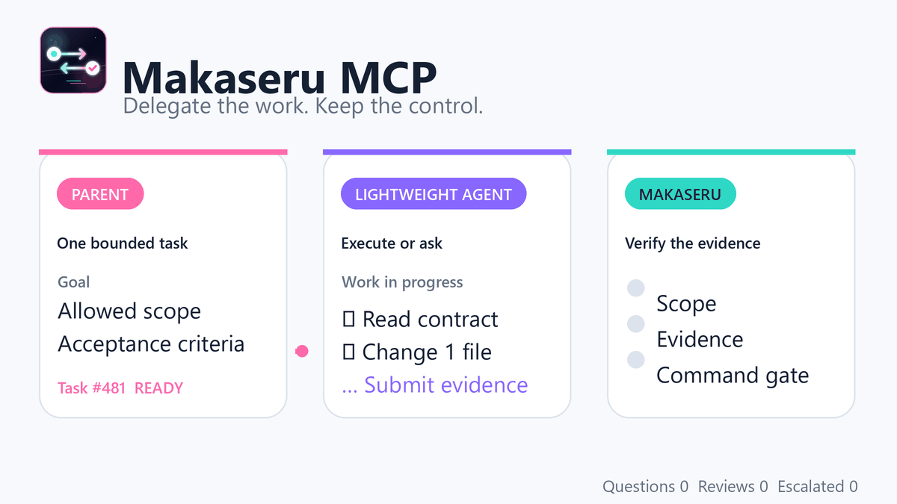

# Makaseru MCP

**Delegate the work. Keep the control.**



Makaseru gives GitHub Copilot Chat a Model Context Protocol (MCP) server for bounded, verifiable subagent work. Delegate a small coding task to a lightweight model, require it to pause when requirements are unclear, and check scope, evidence, and workspace state before accepting completion.

## Why Makaseru?

Lightweight agents are fast and cost-effective, but unconstrained delegation can produce predictable failures:

- **Scope creep:** the agent modifies files outside the intended module or directory.
- **Silent guesswork:** the agent chooses an interpretation instead of stopping for a parent decision.
- **Premature completion:** the agent reports success without checking the actual Git diff, evidence, or test result.

Makaseru enforces a **Contract -> Execute or Ask -> Verify** lifecycle. The parent defines the boundary, the child executes or pauses, and the server checks the submitted result before it is accepted.

## How It Works

1. **Dispatch:** The parent registers one bounded task with acceptance criteria, allowed paths, and optional verification gates. Makaseru returns a `childHandoffPrompt` while keeping the `parentSecret` private.
2. **Execute or pause:** The child accepts the handoff with `makaseru_accept_subtask`. If the task is blocked or requires a choice, it calls `makaseru_ask_parent` instead of guessing.
3. **Verify:** The child submits changed files, evidence, line references, assumptions, and criterion results with `makaseru_complete_subtask`. Makaseru checks the submission against the task contract, workspace state, and configured gates before recording completion.

Unverified assumptions can move a task to `NEEDS_PARENT_REVIEW` instead of completing it automatically.

## Quick Start

1. Install the extension from the VS Code Marketplace, or open Quick Open (`Ctrl+P` / `Cmd+P`) and run:

   ```text
   ext install ShunsukeF.makaseru-mcp
   ```

2. Configure the command names that verification gates may execute. The setting is a comma-separated string:

   ```json
   {
     "makaseru.allowedCommands": "cargo,npm,bun,pnpm,yarn,dotnet,pytest,python,go,git"
   }
   ```

3. Ask your parent Copilot Chat agent to dispatch one bounded task with `makaseru_dispatch_subtask`.
4. Pass only the returned `childHandoffPrompt` to the child agent. Keep `parentSecret` private.
5. Let the child execute or ask for a decision, then submit the result with `makaseru_complete_subtask`. Review any task that remains in `NEEDS_PARENT_REVIEW`.

## MCP Tools

| Tool | Role | Purpose |
| --- | --- | --- |
| `makaseru_dispatch_subtask` | Parent | Register one bounded task with criteria, allowed scope, and optional gates. |
| `makaseru_accept_subtask` | Child | Accept the handoff and retrieve the contract and first execution step. |
| `makaseru_ask_parent` | Child | Pause and ask a concrete question when blocked or faced with a choice. |
| `makaseru_answer_question` | Parent | Answer an open question and resume the delegated task. |
| `makaseru_complete_subtask` | Child | Submit changed files, evidence, assumptions, and criterion results. |
| `makaseru_review_completion` | Parent | Inspect verification and resolve a task that needs review. |
| `makaseru_collect_report` | Parent | Retrieve the verified state, open questions, and final report. |
| `makaseru_list_tasks` | Parent | List active tasks and their current handoff state. |

## MCP Resources

- `makaseru://tasks/{taskId}/contract?handoffToken=...`
- `makaseru://tasks/{taskId}/state?handoffToken=...`
- `makaseru://board/active?parentSessionId=...&parentSecret=...`

Task resources expose only the child-visible contract and state. The parent board expands waiting and review tasks while keeping completed tasks compact. Resource responses never include `parentSecret` or `handoffToken`.

## Verification Gates

Makaseru stores task state in a SQLite-compatible database and verifies:

- task identity and state transitions;
- allowed file scope;
- actual workspace file changes;
- evidence for every acceptance criterion;
- file and line references;
- optional file-content and command-exit gates.

Verification commands are restricted to the command names configured by `makaseru.allowedCommands`. Objective checks run outside the database lock, and Makaseru rejects stale completion results if task state changes during verification.

## Workspace Isolation and Status

Each VS Code workspace receives a distinct MCP server definition and SQLite-compatible database keyed by the resolved workspace path. Cross-process file locking protects state transitions. Schema checks migrate supported databases while stopping on unknown future versions without modifying them.

The status bar shows the number of tasks waiting for a parent answer, waiting for review, and escalated. Makaseru publishes these counts to a secret-free status file and refreshes the display periodically.

## Security Note

Keep `parentSecret` private. Pass only `childHandoffPrompt` to the child agent. Task resources expose child-visible state without returning parent secrets or child handoff tokens.
