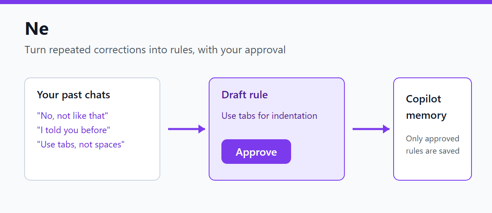
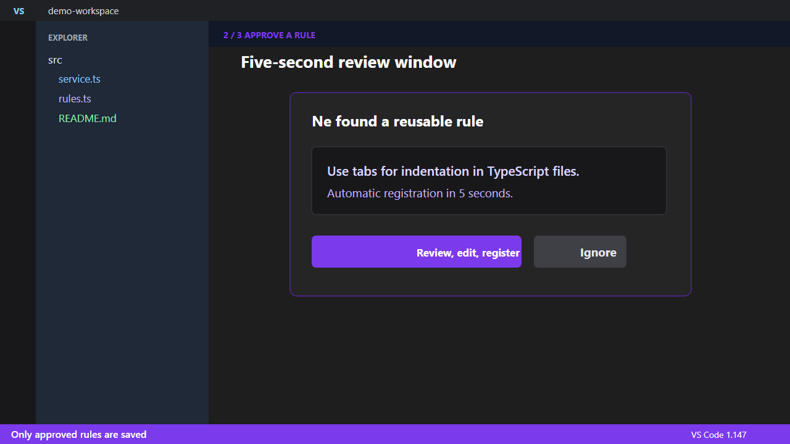

# Ne: make Copilot remember the correction you keep repeating

If every new chat starts the same avoidable back-and-forth, Ne finds correction patterns across past sessions and turns them into a concrete rule proposal. It explains the likely root cause, gives you a five-second review window, and supports editing, rollback, scope selection, and merging before the rule stays.

Your repeated instruction becomes reusable project knowledge instead of another line you have to type again.

[Japanese README](https://github.com/furukawa658/vscode-chat-tools/blob/main/extensions/ne-memory/README.ja.md)

[Watch the demo](https://raw.githubusercontent.com/furukawa658/vscode-chat-tools/main/extensions/ne-memory/images/demo.mp4)

## Commands

| Command | Details |
| --- | --- |
| `Ne: Measure Repeated Corrections` | Shows the number and share of corrections in your last 20 chats. No model is used. |
| `Ne: Analyze Corrections and Save a Rule` | Drafts rules from your corrections and writes them only if you choose to register in the approval dialog. |
| `Ne: Undo a Saved Rule` | Pick from the registration history to undo.

## How to use

1. Run the count command first to see how often you restate things.
2. Run the analyze command. Ne sends examples to the selected language model and opens a five-second registration notice.
3. Let the timer finish to register, or choose `Review, edit, and register` to open the structured Markdown review tab.
4. Choose `Ignore` to roll back an automatic registration. In the review tab, CodeLens provides confirm, rollback, scope switch, and merge-target actions.

## What is sent and written

- Correction text and structured response metadata are sent to the selected VS Code language model only after the confirmation prompt.
- Ne separates the repeated surface instruction from the supported root cause and requires an actionable rule. A malformed or incomplete model proposal is rejected instead of being registered from fallback text.
- Scanning is limited to the current workspace by default. Enable `ne.scanAllWorkspaces` to scan the local workspace storage for other workspaces.
- Global rules are written to `globalStorage/github.copilot-chat/memory-tool/memories/user-preferences.instructions.md`.
- Workspace rules are written to `.github/copilot-instructions.md` in the first workspace folder.
- Automatic registration happens after the configured countdown. `Ignore` and review rollback remove only the exact Ne rule, so later unrelated edits remain intact.

## Good to know

- It depends on the chat save format and the memory location, which are internal to Copilot Chat. A change on their side may break it.
- Detection uses a small set of marker phrases, so it can miss corrections or flag false ones. The count command shows the detection rate.
- A cluster is only proposed when the correction appears in at least `ne.minimumSessions` different chats. Repeated turns inside one chat do not satisfy that threshold.
- Switching review scope clears the selected merge target, preventing a rule from one file from being used against another scope.
- Verified on VS Code 1.147 and Copilot Chat 0.75.

## Settings

| Setting | Default | Description |
| --- | --- | --- |
| `ne.scanAllWorkspaces` | `false` | Scan chat sessions for every local workspace |
| `ne.minimumSessions` | 2 | Different sessions required for a repeated-correction cluster |
| `ne.maxSessions` | 100 | Maximum recent session files to inspect |
| `ne.defaultScope` | `Global` | Initial target: `Global` or `Workspace` |
| `ne.autoRegisterSeconds` | 5 | Delay before automatic registration |

## Related tools

| When you need... | Extension | Role |
| --- | --- | --- |
| Searchable lessons from past tasks | [Kioku](https://marketplace.visualstudio.com/items?itemName=ShunsukeF.kioku-search) | Stores reusable outcomes, causes, and lessons across chats. |
| A fresh chat before context gets overloaded | [Tsugi](https://marketplace.visualstudio.com/items?itemName=ShunsukeF.tsugi) | Creates a reviewed handoff prompt for the next chat. |
| Overnight continuation with a credit limit | [Eien](https://marketplace.visualstudio.com/items?itemName=ShunsukeF.eien) | Resumes stalled work and stops at the configured budget. |
| The complete Copilot Chat workflow | [Copilot Chat Power Pack](https://marketplace.visualstudio.com/items?itemName=ShunsukeF.vscode-chat-tools-pack) | Installs Tsugi, Eien, and Ne together. |

Bugs and requests: [GitHub Issues](https://github.com/furukawa658/vscode-chat-tools/issues). License: MIT.
