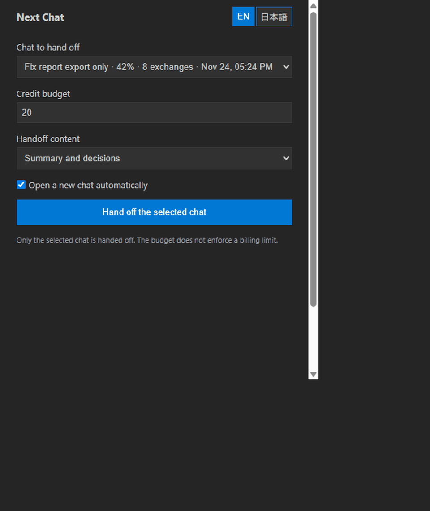

# Tsugi: 長いチャットを捨てずに、次へ進む

## 新機能: サイドバーで引き継ぐチャットを選ぶ

Tsugiのサイドバーから、引き継ぎ作業を毎回同じ操作で行える。

- 同じワークスペースに複数のチャットがある場合も、引き継ぐチャットを指定する。
- 次のチャットに使うAIクレジット予算を設定する。
- 要約のみ、要約と判断事項、すべての引継ぎ内容を選ぶ。
- 新しいチャットを自動で開くか、引き継ぎ文をクリップボードへコピーする。
- サイドバーの表示を英語と日本語で切り替える。

Tsugiのアクティビティバーアイコンからサイドバーを開く。選んだチャットは別のチャットが更新されても切り替わらない。クレジット値は引き継ぎプロンプトへ次チャットの目標として記載する。VS Codeには課金上限をTsugiから強制できるBilling APIがないため、この設定は実際の課金上限ではなく予算の目安と確認補助だ。

会話が長くなると、Copilotが指示を見落とし、応答にも時間がかかる。Tsugiはコンテキストの使用率を表示し、目標・直近の判断・Git状態・対象ファイルを新しいチャットの入力欄へ移す。引き継ぎにモデルを呼ばないため、チャットを替えるだけで追加トークンを使わない。

## こんな経験はないか

- 長いやり取りの途中から、同じ指摘を何度も繰り返している
- 新しいチャットへ切り替えたいが、経緯を書き直すのが面倒
- 複数チャットがあり、どの内容を引き継ぐか分からない
- コンテキストの残量が分からず、切り替える時期を逃す

## できること

| 機能 | 内容 |
| --- | --- |
| 次チャットサイドバー | 引き継ぐチャット、クレジット目標、引き継ぎ内容、新チャットの自動起動、英語・日本語表示を1か所で設定できる |
| チャットの明示選択 | 選んだチャットは、別チャットが更新されても維持する |
| 使用率の常時表示 | 選んだチャットの使用率をステータスバーに表示する。80%（設定で変更可）を超えると警告色になる |
| 1クリックで引き継ぎ | ステータスバーまたはサイドバーから、選んだチャットを新しいチャットへ引き継ぐ |
| 1つのチャットを複数タスクへ分割 | `Tsugi: Split into Separate Task Chats` で独立タスクの候補を確認し、選んだタスクごとに別チャットを作る |
| タスク単位の引き継ぎ | 各チャットへ、そのタスクの目標、関連ファイル、確定事項、受入条件、該当する直近のやり取り、関連ファイルだけのGit差分を入れる |
| 引き継ぎ文の中身 | 最初の依頼、直近のやり取り、全ワークスペースフォルダーのGit状態 |
| 送信はしない | 入力欄に入れるだけ。内容を確認・編集してから送信できる |
| 引き継ぎ文の保存 | 拡張機能の保存領域にも残せる（`tsugi.saveHandoff`） |

## 使い方

1. Tsugiのサイドバーを開く。
2. 引き継ぐチャットを選ぶ。
3. 引き継ぎ内容を選び、`選んだチャットを新チャットへ引き継ぐ` を押す。
4. 新しいチャットに入った引き継ぎ文を確認し、送信する。

コマンドパレットの `Tsugi: Hand Off to a New Chat` と `Tsugi: Split into Separate Task Chats` からも実行できる。複数チャットがある場合は、元になるチャットを選ぶ。分割時は選んだ会話をモデルへ送る前に確認を求め、提案の構造を検証してから、選んだ各タスクを別チャットの未送信入力として開く。

## プライバシー

- 引き継ぎ文を自動送信しない。
- 分割時だけ、確認後に選んだ会話をVS Codeで選択中の言語モデルへ送る。
- ファイルは読むだけで、書き込むのは引き継ぎ文の保存だけだ。

## 知っておくこと

- Copilot Chatが公開していない保存形式（`chatSessions/*.jsonl`）を読む。形式が変わると表示できない場合がある。
- ステータスバーと引き継ぎは、サイドバーで選んだチャットを使う。まだ選んでいなければ、最後に更新されたチャットから始める。
- 現在の合計にシステム指示やツール定義が含まれているため、追加オーバーヘッドの既定値は0だ。
- 動作確認: VS Code 1.147、Copilot Chat 0.75。

## 設定

| 設定 | 既定値 | 内容 |
| --- | --- | --- |
| `tsugi.language` | `en` | サイドバーの表示言語。`en`または`ja` |
| `tsugi.nextChatCredits` | 20 | 引き継ぎプロンプトへ追加する次チャットのAIクレジット目標。課金上限を強制しない |
| `tsugi.handoffMode` | `summary-decisions` | 引き継ぎ内容。`summary-only`、`summary-decisions`、`full` |
| `tsugi.autoOpenNewChat` | true | 引き継ぎ時に新チャットへ自動で進む。falseならクリップボードへコピー |
| `tsugi.warnPercent` | 80 | 警告色にする使用率（%） |
| `tsugi.saveHandoff` | true | 引き継ぎ文をファイルへ保存する |
| `tsugi.baseOverheadTokens` | 0 | 保存済みの合計に含まれないシステム・MCPオーバーヘッドを補う |

## 関連する拡張機能

- [Eien](https://marketplace.visualstudio.com/items?itemName=ShunsukeF.eien): 夜間に止まったチャットを再開させる
- [Ne](https://marketplace.visualstudio.com/items?itemName=ShunsukeF.ne-memory): 繰り返した修正指示をルール化する
- 3つまとめて入れる: [Pack](https://marketplace.visualstudio.com/items?itemName=ShunsukeF.vscode-chat-tools-pack)

不具合・要望は [GitHub](https://github.com/furukawa658/vscode-chat-tools/issues) へ。
