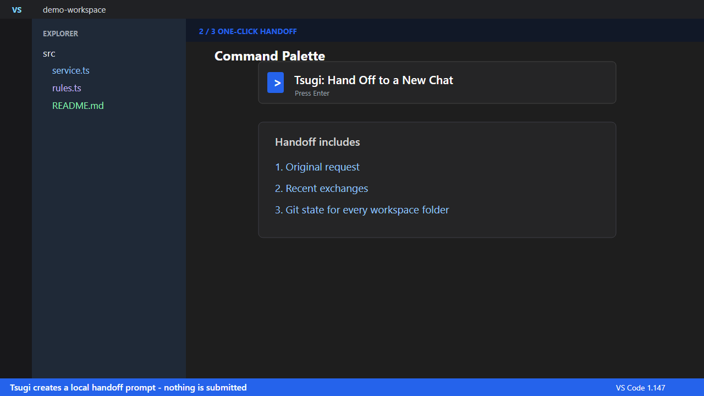

# Tsugi: hand off a long Copilot chat in one click

The longer a chat gets, the more Copilot forgets your instructions and the slower it responds. Tsugi shows context usage in the status bar and carries your work over to a fresh chat. It does not call a model to summarize, so it uses no extra tokens.

[Japanese README](https://github.com/furukawa658/vscode-chat-tools/blob/main/extensions/tsugi/README.ja.md)

[Watch the demo](https://raw.githubusercontent.com/furukawa658/vscode-chat-tools/main/extensions/tsugi/images/demo.mp4)

## Does this sound familiar?

- Halfway through a long conversation, you repeat the same correction again and again.
- You want a new chat, but rewriting the background is a chore.
- You cannot tell how much context is used, so you miss the right moment to switch.

## Features

| Feature | Details |
| --- | --- |
| Live usage in the status bar | Recalculates from the latest turn's `promptTokens + completionTokens` whenever the session file changes. It shows prompt categories and tools in the tooltip. |
| One-click handoff | Click the status bar to put a handoff prompt into a new chat input. The saved model and mode are inherited when available. |
| One chat to many task chats | Run `Tsugi: Split into Separate Task Chats`, review the model's task list, and choose one or more tasks to place in separate chats. |
| What the handoff contains | The first request, recent exchanges, and the Git state of every workspace folder. |
| Nothing is sent for you | The text only lands in the input box. You review and edit it before sending. |
| Optional file copy | The handoff can also be saved to the extension storage (`tsugi.saveHandoff`). |

## How to use

1. Install the extension. The usage appears in the status bar.
2. When it turns to the warning color, click it.
3. Review the handoff prompt in the new chat and send it.

You can also run `Tsugi: Hand Off to a New Chat` or `Tsugi: Split into Separate Task Chats` from the Command Palette. Split asks for confirmation before sending the recent transcript to the selected language model, then leaves every new prompt unsent for review.

## Privacy

- Nothing is sent to any external service.
- Files are only read. The only write is the optional handoff copy.

## Good to know

- It reads the chat save format (`chatSessions/*.jsonl`), which Copilot Chat does not publish. If the format changes, Tsugi stops showing values and warns you.
- If token fields are unavailable, run `Developer: Set Log Level...`, choose GitHub Copilot Chat, and select `Debug` or `Trace`.
- The usage shown is for the most recently updated chat in the workspace. It can differ from the chat on screen.
- The base overhead correction defaults to 0 because current prompt totals already include system instructions and tool definitions in the verified format.
- Verified on VS Code 1.147 and Copilot Chat 0.75.

## Settings

| Setting | Default | Description |
| --- | --- | --- |
| `tsugi.warnPercent` | 80 | Usage (%) at which the status bar turns to the warning color |
| `tsugi.saveHandoff` | true | Also save the handoff text to a file |
| `tsugi.baseOverheadTokens` | 0 | Additional system and MCP overhead when the saved prompt total undercounts it |

## Related extensions

- [Eien](https://marketplace.visualstudio.com/items?itemName=ShunsukeF.eien): resume chats that stall overnight
- [Ne](https://marketplace.visualstudio.com/items?itemName=ShunsukeF.ne-memory): turn repeated corrections into rules
- Install all three: [Pack](https://marketplace.visualstudio.com/items?itemName=ShunsukeF.vscode-chat-tools-pack)

Bugs and requests: [GitHub Issues](https://github.com/furukawa658/vscode-chat-tools/issues). License: MIT.
