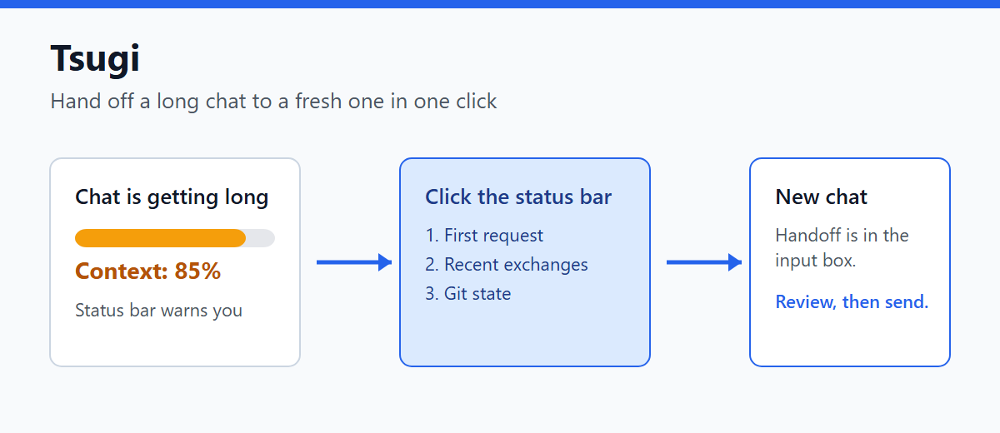

# Tsugi: keep the task, lose the bloated chat

A long Copilot conversation starts missing instructions and taking longer to answer. Tsugi shows the moment that context is filling up, then opens a fresh chat with the goal, recent decisions, Git state, and relevant task context already in the input. No model call is used for a handoff, so changing chats does not spend extra tokens.

Use it when you would rather continue working than rewrite the story from memory.

[Japanese README](https://github.com/furukawa658/vscode-chat-tools/blob/main/extensions/tsugi/README.ja.md)

[Watch the demo](https://raw.githubusercontent.com/furukawa658/vscode-chat-tools/main/extensions/tsugi/images/demo.mp4)

## Does this sound familiar?

- Halfway through a long conversation, you repeat the same correction again and again.
- You want a new chat, but rewriting the background is a chore.
- You cannot tell how much context is used, so you miss the right moment to switch.

## Features

| Feature | Details |
| --- | --- |
| Fast live usage in the status bar | A resident Zig scanner reads the latest indexed token patches whenever the session file changes, without reconstructing the full chat object for every refresh. |
| No Zig setup required | Small native scanners ship for Windows, Linux, and macOS. If a scanner cannot read a session, Tsugi falls back to the JavaScript replay implementation. |
| One-click handoff | Click the status bar to put a handoff prompt into a new chat input. The saved model and mode are inherited when available. |
| One chat to many task chats | Run `Tsugi: Split into Separate Task Chats`, review the proposed independent tasks, and choose one or more tasks to place in separate chat sessions. |
| Task-filtered split context | Each split prompt contains that task's goal, relevant files, decisions, acceptance checks, matching exchanges, and Git changes limited to those files. |
| What the handoff contains | The first request, recent exchanges, and the Git state of every workspace folder. |
| Nothing is sent for you | The text only lands in the input box. You review and edit it before sending. |
| Optional file copy | The handoff can also be saved to the extension storage (`tsugi.saveHandoff`). |

## How to use

1. Install the extension. The usage appears in the status bar.
2. When it turns to the warning color, click it.
3. Review the handoff prompt in the new chat and send it.

You can also run `Tsugi: Hand Off to a New Chat` or `Tsugi: Split into Separate Task Chats` from the Command Palette. Split asks for confirmation before sending the recent transcript to the selected language model. It validates the proposed task structure, lets you choose which tasks to create, and leaves every prompt unsent in a separate chat session for review.

## Privacy

- Handoff itself is not sent anywhere automatically.
- Split sends the recent transcript to the selected VS Code language model only after the confirmation prompt.
- Files are only read. The only write is the optional handoff copy.

## Good to know

- It reads the chat save format (`chatSessions/*.jsonl`), which Copilot Chat does not publish. If the Zig scanner cannot read a session, Tsugi uses the JavaScript implementation and warns only when neither path can read it.
- Model metadata and context size are parsed once in JavaScript. Later updates use the resident Zig process, so a large session object is not reconstructed for each status-bar refresh.
- If token fields are unavailable, run `Developer: Set Log Level...`, choose GitHub Copilot Chat, and select `Debug` or `Trace`.
- The usage shown is for the most recently updated chat in the workspace. It can differ from the chat on screen.
- The base overhead correction defaults to 0 because current prompt totals already include system instructions and tool definitions in the verified format.
- Verified on VS Code 1.147 and Copilot Chat 0.75.

## Settings

| Setting | Default | Description |
| --- | --- | --- |
| `tsugi.warnPercent` | 80 | Usage (%) at which the status bar turns to the warning color |
| `tsugi.saveHandoff` | true | Also save the handoff text to a file |
| `tsugi.baseOverheadTokens` | 0 | Additional system and MCP overhead when the saved prompt total undercounts it |

## Related extensions

- [Eien](https://marketplace.visualstudio.com/items?itemName=ShunsukeF.eien): resume chats that stall overnight
- [Ne](https://marketplace.visualstudio.com/items?itemName=ShunsukeF.ne-memory): turn repeated corrections into rules
- Install the complete Copilot Chat workflow (Context + Rules + Credit Guard): [Copilot Chat Power Pack](https://marketplace.visualstudio.com/items?itemName=ShunsukeF.vscode-chat-tools-pack)

Bugs and requests: [GitHub Issues](https://github.com/furukawa658/vscode-chat-tools/issues). License: MIT.
